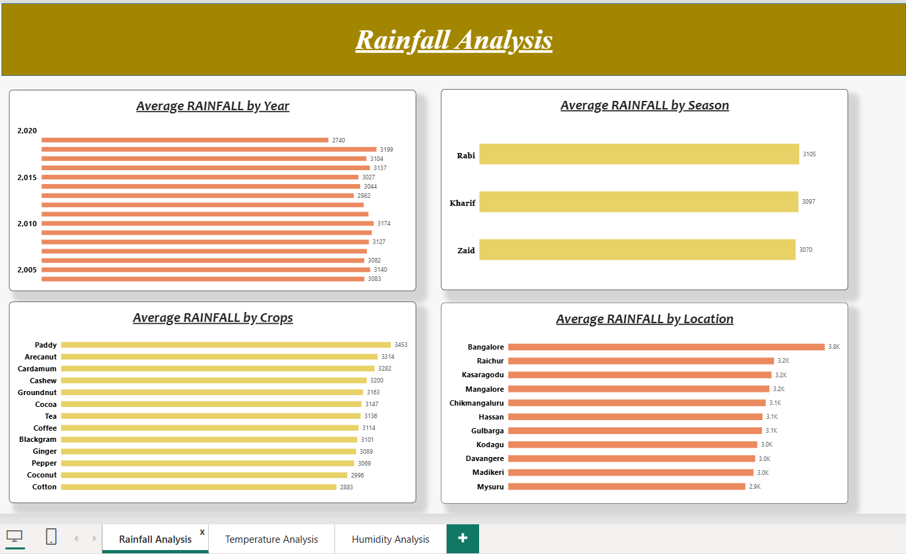

# climate-analysis-aws-snowflake-powerbi
An end-to-end data project that stores agricultural weather data in **Amazon S3**, loads it into **Snowflake** through a secure storage integration, transforms it with **SQL**, and visualizes it in a three-page **Power BI** report.

## Architecture

```
CSV file  →  Amazon S3 bucket  →  IAM role  →  Snowflake storage integration & stage
                                                        │
                                                        ▼
                                          Snowflake SQL transformations
                                                        │
                                                        ▼
                                       Power BI Desktop  →  Power BI Service
```

## Tools Used

| Layer | Tool |
|---|---|
| Storage | Amazon S3, AWS IAM |
| Warehouse | Snowflake (SQL) |
| Visualization | Power BI Desktop and Power BI Service |

## Dataset

`data/data_season_1.csv` has 3,158 rows and 12 columns covering **2004–2019**, **11 locations** (Karnataka and nearby districts), **13 crops** and **3 seasons** (Kharif, Rabi, Zaid).

Columns: Year, Location, Area, Rainfall, Temperature, Soil type, Irrigation, yeilds, Humidity, Crops, price, Season.

> The column is spelled `yeilds` in the source data and is kept as is so the Snowflake table and the Power BI report keep working.

## Project Steps

| # | Step | File |
|---|---|---|
| 1 | Create an S3 bucket and upload the CSV | (AWS console) |
| 2 | Create an IAM role that lets Snowflake read the bucket | `aws/s3_read_policy.example.json` |
| 3 | Create the storage integration in Snowflake and update the role's trust policy | `snowflake/01_storage_integration.sql`, `aws/trust_policy.example.json` |
| 4 | Create the database, table and stage, then load the data from S3 | `snowflake/02_database_stage_and_load.sql` |
| 5 | Transform the data (copy table, scale rainfall and area) | `snowflake/03_transformations.sql` |
| 6 | Add `Year_Group` and `rainfall_groups` (Low / Medium / High) columns | `snowflake/04_year_and_rainfall_groups.sql` |
| 7 | Import the data into Power BI from Snowflake and build the report | `powerbi/AWSSnowflake_Project.pbit` |
| 8 | Publish the report to Power BI Service | |

### Rainfall groups

| Group | Rainfall range |
|---|---|
| Low | 255 to under 1200 |
| Medium | 1200 to under 2800 |
| High | 2800 and above |

## Power BI Report

The report has three pages, each showing the average of one measure by **year, season, crop and location**.

### Rainfall Analysis


### Temperature Analysis


### Humidity Analysis


## Key Insights

- **Bangalore** has the highest average rainfall (about 3.8K) and **Mysuru** the lowest (about 2.9K) among the 11 locations.
- By crop, **Paddy** has the highest average rainfall (3,453) and **Cotton** the lowest (2,883).
- Average rainfall is almost the same across seasons (Rabi 3,105, Kharif 3,097, Zaid 3,070).
- Average humidity is nearly flat at about 55 to 56 across years, seasons, crops and locations.

## Data Quality Note

The `Temperature` column contains values from about 27 up to 222 (767 rows are above 50), which cannot all be real temperatures in °C. They may be mixed units or entry errors. The Temperature Analysis page shows the data as it is, so read it with that in mind.

## How to Reproduce

1. Upload `data/data_season_1.csv` to your own S3 bucket.
2. Create an IAM role with the policy in `aws/s3_read_policy.example.json` (replace `<YOUR_BUCKET_NAME>`).
3. Run `snowflake/01_storage_integration.sql` after replacing `<AWS_ACCOUNT_ID>` and `<ROLE_NAME>`. Then run `DESC INTEGRATION PBI_Integration;` and put the returned `STORAGE_AWS_IAM_USER_ARN` and `STORAGE_AWS_EXTERNAL_ID` into the role's trust policy (`aws/trust_policy.example.json`).
4. Run the remaining SQL files in order (`02`, `03`, `04`).
5. Open `powerbi/AWSSnowflake_Project.pbit` in Power BI Desktop, enter your own Snowflake account, warehouse and credentials when prompted, and refresh.

## Security

No credentials are stored in this repository. Account IDs, role ARNs and external IDs are replaced with `<PLACEHOLDERS>`.

## Credits

Built while following the **<Master Data Analysis: Python, Stats, Gen AI, EDA, AWS, SQL ,Excel, Power BI, Tableau,ETL,Snowflake & Feature Engineering>** course on AWS + Snowflake + Power BI.

